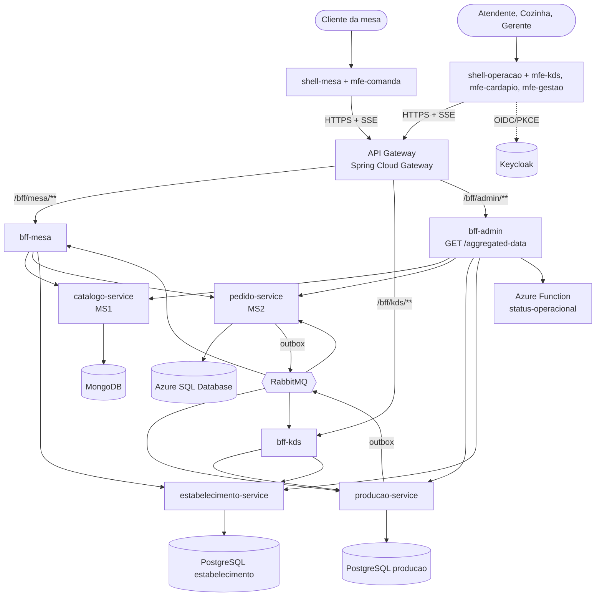

# SmartKDS & Menu

Plataforma SaaS multi-tenant de **cardápio digital**, **comanda eletrônica** e **Kitchen Display System (KDS)**.
O cliente lê o QR Code da mesa, monta o pedido no próprio celular e confirma; a cozinha recebe um ticket por
estação em tempo real (SSE), com cronômetro e alerta de atraso; o gerente acompanha tudo num painel agregado.

Implementação da arquitetura documentada no arc42 *“SmartKDS & Menu — Documentação de Arquitetura de Software”*
(C4 níveis 1 a 4, UML, DER e Software Architecture Canvas).

**Alunos:** Arthur Sales Major · Vinicius Ogasawara · Luiz Eduardo Assi · Rodrigo Petrelli Glir

---

## Arquitetura



| Estilo exigido | Onde está |
|---|---|
| **Microfrontend** | `frontend/`: 2 shells host + 4 remotes, Module Federation (Vite) — build e deploy independentes |
| **API Gateway** | `gateway/api-gateway` (Spring Cloud Gateway): JWT/Keycloak, CORS, rate limit, correlação, roteamento |
| **BFF** | `bff/bff-mesa`, `bff/bff-kds`, `bff/bff-admin` (Node.js 22 + Fastify + TypeScript) |
| **Microservices + Database per Service** | `services/*` (Java 21 + Spring Boot 3.5): **MongoDB Atlas** no catálogo, **Azure SQL** no pedido, um PostgreSQL por serviço na produção e no estabelecimento |
| **Vertical Slice + Clean Architecture** | `features/<fatia>` em cada serviço, núcleo `shared/dominio` em Java puro — verificado por **ArchUnit** |
| **Eventos assíncronos** | RabbitMQ com Transactional Outbox, consumo idempotente (inbox) e DLQ; contrato em `contratos/asyncapi` |
| **Serverless** | `functions/status-operacional` (Azure Functions v4, HTTP Trigger) |

### Requisitos da entrega → implementação

| Requisito do enunciado | Implementação |
|---|---|
| Microfrontend (React) consumindo **apenas o BFF** | Remotes chamam só `/bff/**` via gateway; testes de arquitetura proíbem `fetch` fora de `src/api` e import entre remotes |
| BFF Node.js com agregação e proxy CRUD | `bff-admin` (agregação + proxy CRUD), `bff-mesa` e `bff-kds` (composição + SSE) |
| **`GET /aggregated-data`** consumindo MS1, MS2 e Azure Function | `bff-admin`: chama `catalogo-service`, `pedido-service` e a Function **em paralelo** (+ indicadores da produção) e devolve um único response; fonte fora do ar aparece como `indisponivel` sem derrubar a resposta |
| Microserviço 1 com MongoDB Atlas, CRUD completo e Swagger | `catalogo-service`: itens (POST/GET/GET por id/PUT/PATCH/DELETE) + versões imutáveis do cardápio; Swagger via springdoc |
| Microserviço 2 com Azure SQL, CRUD completo e Swagger | `pedido-service` (**Azure SQL Database**): comanda (POST abrir, GET listar/obter, PATCH alterar item, DELETE cancelar item e comanda, POST fechar), confirmação com Outbox, saga de cancelamento, auditoria; migrações também para PostgreSQL |
| Azure Function (HTTP Trigger) | `status-operacional`: faixa horária, pico e multiplicador de tempo de preparo |
| Eventos documentados (“Swagger de eventos”) | AsyncAPI 3.0 em `contratos/asyncapi/smartkds-eventos.yaml`, publicado em `/bff/admin/eventos` |
| API Gateway | `gateway/api-gateway` |
| Clean Architecture (Domain / Application / Infrastructure / API) | Em cada serviço: **Domain** = `shared.dominio` (Java puro); **Application** = `Handler`/`Query` de cada fatia; **Infrastructure** = `shared.persistencia`, `outbox`, `inbox`, `integracao`; **API** = `Endpoint`/`Listener` de cada fatia |
| Vertical Slice | `features/<fatia>/` (ex.: `features/confirmarpedido`), uma fatia por funcionalidade, sem `controller/service/repository` globais |
| Testes unitários e de arquitetura | JUnit (domínio + fatias com fakes), integração com PostgreSQL real embutido, **ArchUnit**; Vitest nos BFFs, Function e frontends, com testes de arquitetura por varredura de imports |
| Docker Hub | `Dockerfile` em cada serviço/BFF/gateway/function + `scripts/publicar-imagens.sh` + workflow `cd.yml` |
| README em cada projeto | `README.md` em cada um dos 15 projetos e nas pastas `frontend/` e `bff/` |
| Repositórios públicos no GitHub | `scripts/publicar-github.sh` cria um repositório por parte (microfrontends, BFF, MS Mongo, MS SQL, Function, gateway, demais serviços) + o guarda-chuva |

---

## Estrutura do repositório

```
smartkds-menu/
├── frontend/      shell-mesa, mfe-comanda, shell-operacao, mfe-kds, mfe-cardapio, mfe-gestao (+ Dockerfile genérico)
├── bff/           bff-mesa, bff-kds, bff-admin
├── gateway/       api-gateway
├── services/      catalogo-service, pedido-service, producao-service, estabelecimento-service
├── functions/     status-operacional (Azure Function)
├── contratos/     asyncapi/smartkds-eventos.yaml
├── infra/         postgres/init.sql, keycloak/realm-smartkds.json, azure/implantar.sh
├── scripts/       publicar-imagens.sh, publicar-github.sh, popular-demo.sh
├── docs/          ENTREGA.md (links, publicação, vídeo) e arc42-entrega3.html (atualização do arc42 para o PDF)
├── .github/       ci-services.yml, ci-frontend.yml, cd.yml
└── docker-compose.yml
```

## Tecnologias

| Camada | Tecnologia |
|---|---|
| Microfrontends | React 18, TypeScript, Vite 5, `@originjs/vite-plugin-federation`, Vitest + Testing Library |
| API Gateway | Java 21, Spring Cloud Gateway (2025.0), Spring Security OAuth2 Resource Server |
| BFFs | Node.js 22, Fastify 5, TypeScript, `@fastify/swagger` (OpenAPI 3.1), amqplib, Vitest |
| Microsserviços | Java 21, Spring Boot 3.5, Spring Web, Spring Data MongoDB / JPA, Flyway, Spring AMQP, springdoc-openapi, ArchUnit |
| Dados | MongoDB 7 (Atlas), Azure SQL Database / SQL Server 2022 e PostgreSQL 16, todos com isolamento por tenant (RLS no SQL) |
| Mensageria | RabbitMQ 3.13 (CloudAMQP), Transactional Outbox, inbox idempotente, DLQ |
| Serverless | Azure Functions v4 (Node 20, TypeScript) |
| Identidade | Keycloak 25 (OIDC + PKCE), claim `tenant_id` |
| Entrega | Docker, Docker Hub, GitHub Actions, Azure Container Apps, Azure Static Web Apps |

---

## Como rodar localmente

### Opção 1 — tudo com Docker Compose

```bash
docker compose up -d --build          # infraestrutura, 4 serviços, function, 3 BFFs, gateway e 6 microfrontends
./scripts/popular-demo.sh             # cadastra o cardápio de demonstração e publica a versão
```

| O quê | URL |
|---|---|
| Operação (gerente / cozinha / atendente) — modo demonstração | http://localhost:5200 |
| Cliente na mesa (QR Code da Mesa 1) | http://localhost:5100/m/demo-mesa-1 |
| API Gateway | http://localhost:8080 |
| `GET /aggregated-data` | http://localhost:8080/bff/admin/aggregated-data |
| Swagger dos BFFs | http://localhost:8080/bff/mesa/docs · `/bff/kds/docs` · `/bff/admin/docs` |
| Swagger dos microsserviços | http://localhost:8080/docs/catalogo/swagger-ui.html · `pedido` · `producao` · `estabelecimento` |
| Eventos (AsyncAPI) | http://localhost:8080/bff/admin/eventos |
| RabbitMQ | http://localhost:15672 (smartkds / smartkds) |

Com Keycloak: `JWT_HABILITADO=true docker compose --profile keycloak up -d --build` e reconstrua o `shell-operacao`
com `VITE_KEYCLOAK_URL=http://localhost:8180/realms/smartkds` (usuários `gerente`, `cozinha`, `atendente`; senha igual ao usuário).

### Opção 2 — cada projeto isolado

Cada README de projeto traz o comando. Em resumo: serviços Java com `mvn spring-boot:run`, BFFs com `npm run dev`,
Function com `func start`, remotes com `npm run build && npm run preview` e shells com `npm run dev`.
Portas: catálogo 8081, pedido 8082, produção 8083, estabelecimento 8084, gateway 8080, bff-mesa 3001, bff-kds 3002,
bff-admin 3003, function 7071, shell-mesa 5100, mfe-comanda 5101, shell-operacao 5200, mfe-kds 5201, mfe-cardapio 5202, mfe-gestao 5203.

## Testes

```bash
# cada serviço Java e o gateway (inclui ArchUnit e integração com PostgreSQL embutido, sem Docker)
cd services/pedido-service && mvn test
# BFFs, Function e frontends (inclui testes de arquitetura)
cd bff/bff-admin && npm test
```

| Projeto | Testes | Destaques |
|---|---:|---|
| catalogo-service | 19 | 13 regras ArchUnit, versão imutável, publicação |
| pedido-service | 52 | 18 regras ArchUnit, agregado `Comanda` (CRUD), outbox, idempotência; integração em **PostgreSQL real** (45 executam sem Docker) e em **SQL Server/Azure SQL via Testcontainers** (7, executam no CI): RLS, lock otimista, 1 comanda aberta por mesa, trava concorrente da outbox |
| producao-service | 28 | roteamento (precedência da Seção 8.5), SLA, idempotência, SQL dos indicadores e RLS em PostgreSQL real |
| estabelecimento-service | 20 | QR Token, regras de roteamento, dados de demonstração em PostgreSQL real |
| api-gateway | 7 | anti-forja de tenant, modo demonstração, rate limit, ArchUnit de borda |
| bff-mesa / bff-kds / bff-admin | 12 / 11 / 12 | composição, degradação parcial, circuit breaker, SSE por tenant, `/aggregated-data`, testes de arquitetura |
| status-operacional (Function) | 6 | regra pura + teste de arquitetura |
| microfrontends (6) | 28 | componentes, regras de UI e testes de arquitetura (sem import entre remotes, sem token em storage, sem `fetch` fora de `src/api`) |

## Publicar no Docker Hub

```bash
DOCKERHUB_USER=seuusuario TAG=v1 ./scripts/publicar-imagens.sh
# gera e publica docker.io/seuusuario/smartkds-<imagem>:v1 para os 4 serviços, 3 BFFs, gateway e function
```
Ou crie uma tag `v1` no GitHub com os segredos `DOCKERHUB_USERNAME`/`DOCKERHUB_TOKEN` (workflow `cd.yml`).

## Implantação na nuvem

Roteiro em [`infra/azure/implantar.sh`](infra/azure/implantar.sh): MongoDB Atlas (M0), **Azure SQL Database** (criado pelo script), PostgreSQL (Azure Flexible B1ms ou Neon),
CloudAMQP, Azure Container Apps (serviços e BFFs com ingresso **interno**, só o gateway é público), Azure Functions e
Azure Static Web Apps para os microfrontends. Os links para o PDF da Entrega 3 ficam em [`docs/ENTREGA.md`](docs/ENTREGA.md).
