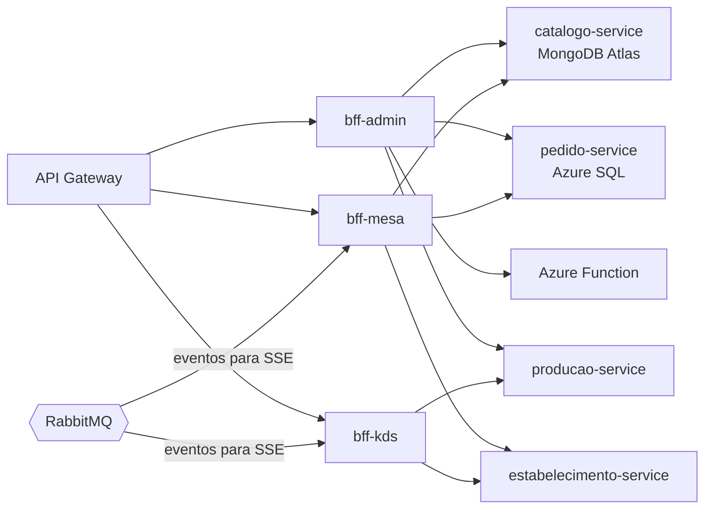

# SmartKDS & Menu — BFFs (Backend for Frontend)

Três BFFs em **Node.js 22 + Fastify 5 + TypeScript**, um por experiência de usuário (ADR-03), atrás do API Gateway (ADR-04).
Responsáveis por **agregação de dados**, **proxy de requisições (CRUD)** e comunicação com os **microsserviços** e a
**Azure Function (HTTP Trigger)**. Não têm banco nem regra de negócio.

| BFF | Experiência | Destaques | Porta |
|---|---|---|---|
| [bff-admin](bff-admin) | Gerente / atendente | **`GET /aggregated-data`** (Microsserviço 1 MongoDB + Microsserviço 2 Azure SQL + Azure Function em um único JSON), proxy CRUD de cardápio, comandas, mesas, estações; AsyncAPI dos eventos | 3003 |
| [bff-mesa](bff-mesa) | Cliente no celular | resolve o QR Code, compõe cardápio + comanda em paralelo, SSE da comanda | 3001 |
| [bff-kds](bff-kds) | Cozinha | fila da estação com SLA calculado no servidor, SSE por estação | 3002 |



Swagger de cada BFF: `<api-gateway>/bff/admin/docs`, `/bff/mesa/docs`, `/bff/kds/docs`. Eventos: `<api-gateway>/bff/admin/eventos`.

## Rodar e testar

```bash
cd bff-admin && npm install && npm run dev     # idem bff-mesa e bff-kds
npm test                                       # unitários, rotas e testes de arquitetura
docker build -t <usuario>/smartkds-bff-admin:v1 bff-admin && docker push <usuario>/smartkds-bff-admin:v1
```

## Alunos

Arthur Sales Major · Vinicius Ogasawara · Luiz Eduardo Assi · Rodrigo Petrelli Glir
