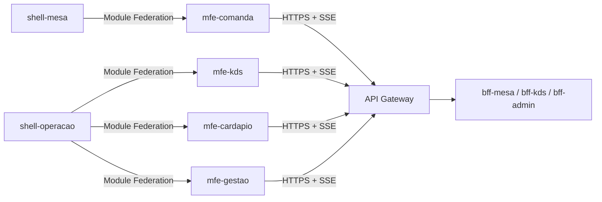

# SmartKDS & Menu — Microfrontends

Camada de apresentação do [SmartKDS & Menu](https://github.com/<org>/smartkds-menu): **2 shells host + 4 remotes**
em React 18 + TypeScript + Vite, compostos em tempo de execução por **Module Federation** (ADR-01).
Os microfrontends consomem **somente os BFFs**, sempre através do API Gateway — nunca um microsserviço.

| Projeto | Papel | Expõe / carrega | Porta local |
|---|---|---|---|
| [shell-mesa](shell-mesa) | Host público aberto pelo QR Code (`/m/{qrToken}`) | carrega `comanda/TelaComanda` | 5100 |
| [mfe-comanda](mfe-comanda) | Cardápio, carrinho e acompanhamento do cliente | `./TelaComanda` | 5101 |
| [shell-operacao](shell-operacao) | Host da operação: login OIDC/PKCE, sessão, rotas | carrega `kds`, `cardapio`, `gestao` | 5200 |
| [mfe-kds](mfe-kds) | Tela de produção (KDS) em tempo real (SSE) | `./TelaProducao` | 5201 |
| [mfe-cardapio](mfe-cardapio) | Edição e publicação do cardápio | `./TelaCardapio` | 5202 |
| [mfe-gestao](mfe-gestao) | Painel do `GET /aggregated-data`, comandas, mesas, auditoria | `./TelaGestao` | 5203 |

## Arquitetura



Regras verificadas por testes de arquitetura em cada projeto: nenhum remote importa outro remote; remotes não leem token
de storage (a sessão vem do shell por props); componentes não chamam `fetch` fora de `src/api`.

## Tecnologias

React 18 · TypeScript 5 · Vite 5 · `@originjs/vite-plugin-federation` · Vitest + Testing Library · nginx (imagem) · Azure Static Web Apps (publicação).

## Como rodar localmente

```bash
# 1) remotes (precisam do build para expor o remoteEntry.js)
for p in mfe-comanda mfe-kds mfe-cardapio mfe-gestao; do (cd $p && npm install && npm run build && npm run preview &) ; done
# 2) shells
cd shell-operacao && npm install && VITE_API_URL=http://localhost:8080 npm run dev     # http://localhost:5200
cd shell-mesa && npm install && VITE_API_URL=http://localhost:8080 npm run dev         # http://localhost:5100/m/demo-mesa-1
# testes
npm test   # em cada projeto
```

Em produção (vídeo da entrega), use as URLs publicadas: `https://<swa-shell-operacao>` e `https://<swa-shell-mesa>/m/demo-mesa-1`.

## Imagem Docker (opcional)

```bash
docker build --build-arg PROJETO=mfe-kds --build-arg VITE_API_URL=https://<gateway> -t <usuario>/smartkds-mfe-kds:v1 .
```

## Alunos

Arthur Sales Major · Vinicius Ogasawara · Luiz Eduardo Assi · Rodrigo Petrelli Glir
